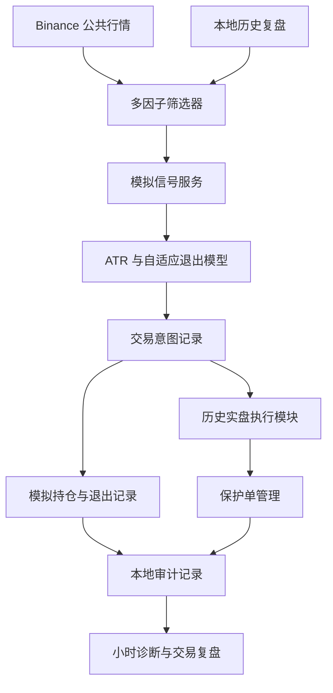

# 架构与数据流

默认配置只走模拟路径。实盘模块保留于代码档案，不在 CI、测试和发布验证中启用。

| 模块 | 职责 |
|---|---|
| `quant/screeners/binance_usdm_15m_trend_screener.py` | 行情、EMA/RSI/ATR、流动性、趋势及资金流等因子、候选评分 |
| `quant/services/paper_signal_service.py` | 模拟持仓、意图、循环、状态保存、退避与历史实盘调度 |
| `quant/services/risk_model.py` | ATR 与信号相关的退出价位计算 |
| `quant/services/live_execution.py` | 签名接口、意图确认、历史下单及保护路径 |
| `quant/services/protection_manager.py` | 条件单检查、失效保护单和保护调整 |
| `quant/services/operation_journal.py` | JSONL 操作理由、可选 MongoDB 镜像 |
| `scripts/binance_usdm_monthly_report.py` | 私有成交与账户流水只读导出、复盘生成 |
| `scripts/review_binance_usdm_trades.py` | 本地逐笔成交与订单聚合复盘 |
| `scripts/build_volume_price_profile.py` | 历史量价画像 |
| `scripts/hourly_quant_review.py` | 服务状态、事件新鲜度、不可观测状态与异常诊断 |
| `scripts/unavailable_request_ip_report.py` | 私有运行环境中访问失败的 IP 统计 |
| `scripts/restart_paper_signal_service.py` | 原有 macOS/screen 实盘服务重启工具，默认不调用 |

核心规则是将“意图已生成”“下单请求已发送”“成交”“保护单已生效”“状态未知”分别记录。历史文档存在过度确定的措辞，需结合[实现限制](implementation-status.md)解释。
